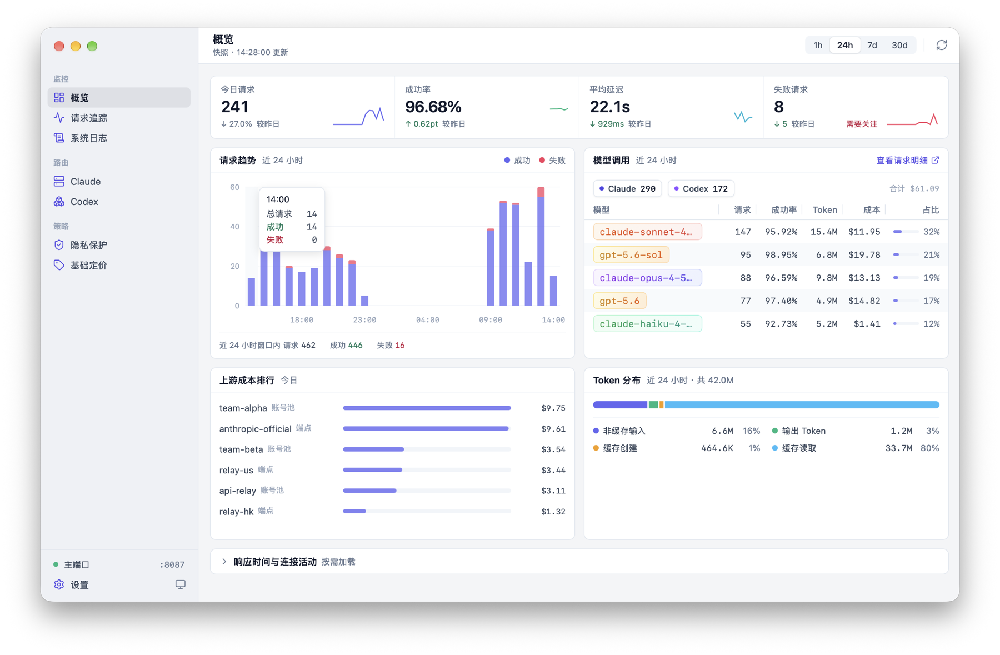
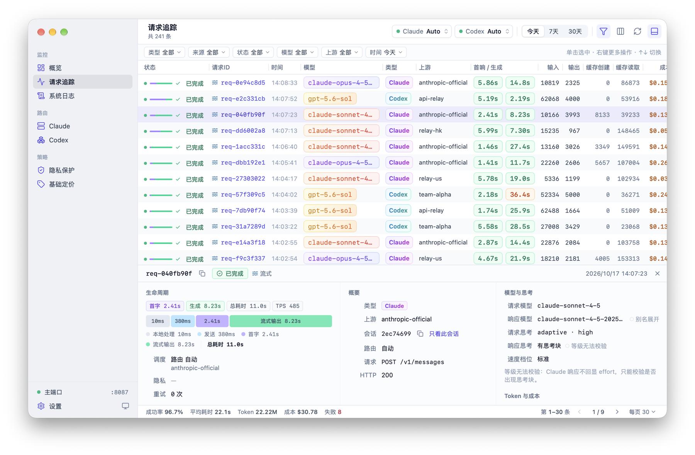
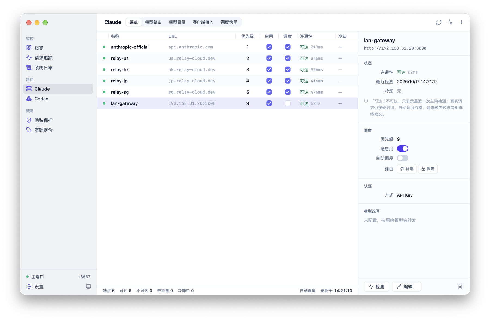
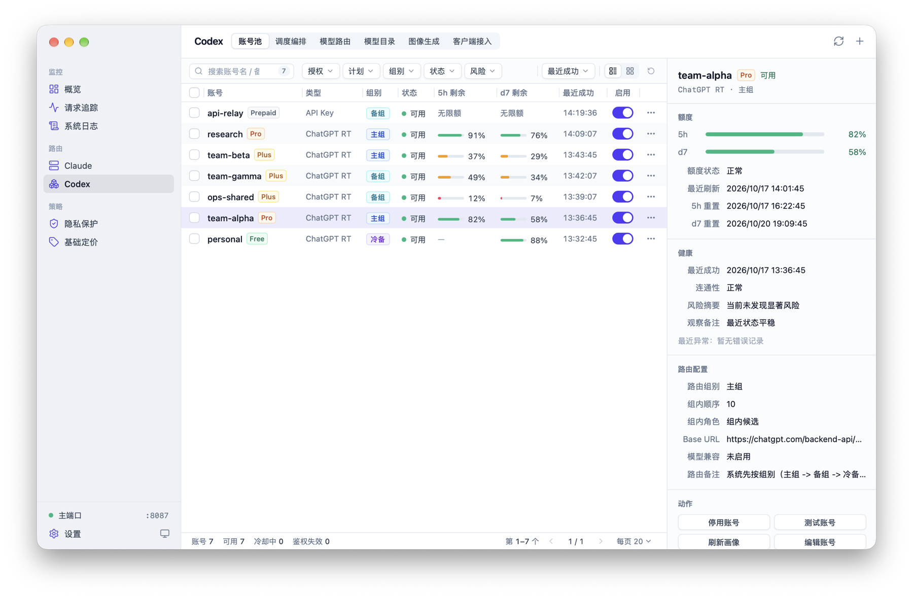

# Sinuo

<p align="center">
  
</p>

<p align="center">
  <strong>Claude Code 与 Codex 的本地网关</strong><br>
  多端点路由 · 按模型分流 · 自动故障转移 · 请求追踪
</p>

<p align="center">
  
  
  
  
  
  
</p>

---

## 概述

Sinuo 是一款基于 [Wails v3](https://wails.io) 构建的跨平台桌面应用，作为 Claude Code、Codex 等 AI 编程工具的本地网关运行。它统一转发 Claude 与 OpenAI / Codex 请求，提供多端点路由、按模型分流、账号池调度与自动故障恢复，并完整记录每个请求的调度过程、耗时、Token 用量与成本。

### 为什么需要它？

- **多上游统一管理** - 多个 Claude 端点与 Codex 账号集中管理，客户端只需配置一个地址
- **按模型分流** - 不同模型走不同上游，未分配的模型明确报错，不会悄悄走错上游
- **高可用** - 上游异常时自动切换，冷却结束后自动恢复
- **看得清** - 每个请求的调度过程、分段耗时、模型与思考等级、Token 和成本一目了然
- **出站隐私保护** - 请求体按规则扫描脱敏，敏感信息不出本机



## 功能特性

### 🚀 Claude 端点与路由

- **端点管理** - 每个端点独立配置 Token / API Key、自定义 Header、超时、模型改写与成本倍率
- **三态路由** - 自动调度、手动优选、手动固定；端点异常时故障转移，冷却结束后自愈，也可一键解除冷却
- **模型路由** - 按请求模型为每个模型指定一组端点，未分配的模型返回 422；带联网工具的请求可单独映射
- **调度快照** - 记录每次调度的候选端点、跳过原因与最终命中，异常时才前台警示
- **模型目录** - 自行维护 `/v1/models` 返回的模型列表

### 🔀 Codex 账号池与路由

- **账号池** - 支持 ChatGPT OAuth 授权与 API Key 账号，自动刷新 Token、账号画像与 5 小时 / 周额度
- **分组编排** - 主组 / 备组 / 冷备三层，支持组内首选与全局固定账号，冷却与鉴权失效自动处理
- **模型路由** - 按模型绑定账号组；联网搜索可指定专用的 OAuth 账号
- **模型目录** - 输出 Codex 可解析的模型能力目录，供 Codex 自动发现模型
- **图像生成** - OpenAI 兼容的生图 / 改图接口单独转发，按次计价，不进账号池调度

### 🔌 独立入口

- **Claude Code 入口**（默认 `127.0.0.1:18088`）- 「端点」模式与主端口一致；「订阅直通」模式把请求原样转发到官方 API，使用本机 Claude Code 已登录的订阅，并在请求页展示订阅额度
- **Codex 入口**（默认 `127.0.0.1:28088`）- 「账号池」或「订阅直通」两种模式，支持 HTTP 与 WebSocket
- 两个入口的模式都可以在托盘或请求页一键切换，不用重启

> ⚠️ 账号池与订阅直通会用你自己的账号凭据访问官方服务，这类用法可能不符合相关服务条款，是否使用请自行评估风险。

### 📊 请求追踪与统计

- **概览** - 今日指标与昨日对比、按小时趋势、模型调用、上游成本排行
- **请求追踪** - 分段耗时（本地处理 · 建连 · 发送 · 首字 · 输出）、请求 / 上游 / 响应模型与思考等级、客户端会话、调度快照与隐私扫描结果
- **成本统计** - 按模型定价与上游倍率计算费用，区分缓存读写计费

### 🔒 出站隐私保护

- **三种模式** - 关闭 / 仅检测 / 脱敏转发，默认关闭
- **规则可维护** - 规则存 SQLite，保存时先编译后落库，原子热替换不重启
- **精确扫描** - 按 JSON 文本字段扫描（含工具调用参数与结果），零命中时请求体逐字节不变
- **不留痕** - 只记录规则名、命中数与耗时，不记录命中原文

### 🖥️ 桌面体验

- **桌面化界面** - 侧边栏 + 统一工具栏，表格 + 检查器，支持快捷键与右键菜单
- **系统托盘** - 关闭窗口后驻留托盘，图标显示请求进行与健康状态；菜单里可直接切换端点 / 账号、开关模型路由、解除冷却
- **暗黑模式** - 跟随系统或手动切换
- **本地存储** - 配置与记录全部存在本地 SQLite，无需额外依赖

## 截图

| 概览 | 请求追踪 |
|:---:|:---:|
|  |  |

| Claude 管理 | Codex 管理 |
|:---:|:---:|
|  |  |

## 快速开始

### 方式一：下载安装包

从 [Releases](https://github.com/xiaozhaodong/sinuo/releases) 页面下载：

| 平台 | 文件 |
|------|------|
| macOS (Intel) | `Sinuo-darwin-amd64.zip` |
| macOS (Apple Silicon) | `Sinuo-darwin-arm64.zip` |
| Windows | `Sinuo-windows-amd64.zip` |
| Linux | `Sinuo-linux-amd64.tar.gz` |

> macOS 安装包只有 ad-hoc 签名、未经公证。首次打开如果提示无法验证开发者，请到「系统设置 → 隐私与安全性」点击「仍要打开」；如果提示「已损坏」，执行 `xattr -dr com.apple.quarantine /Applications/Sinuo.app` 后再打开。

### 方式二：从源码构建

需要 Go 1.25+ 与 Node.js 20.19+。

```bash
# 1. 安装 Wails v3 CLI
go install github.com/wailsapp/wails/v3/cmd/wails3@v3.0.0-beta.27

# 2. 克隆项目
git clone https://github.com/xiaozhaodong/sinuo.git
cd sinuo

# 3. 安装前端依赖
cd frontend && npm install && cd ..

# 4. 开发模式运行
wails3 dev -config ./build/config.yml -port 9245

# 5. 构建生产版本
wails3 task build
```

### 接入客户端

主端口默认是 `127.0.0.1:8087`，被占用时自动顺延，实际端口以侧边栏底部的「主端口」为准；可在「设置」中修改首选端口。

**Claude Code**：在 `~/.claude/settings.json` 中加入：

```json
{
  "env": {
    "ANTHROPIC_BASE_URL": "http://127.0.0.1:8087"
  }
}
```

只想先试一次，可以直接运行 `ANTHROPIC_BASE_URL=http://127.0.0.1:8087 claude`。也可以在「Claude 管理 → 客户端接入」启用 Claude Code 独立入口，页面会给出对应的配置片段。

**Codex**：在「Codex 管理 → 客户端接入」启用 Codex 独立入口，把页面给出的 `openai_base_url` 写入 `~/.codex/config.toml`。

## 配置说明

### 端点配置

端点在应用内「Claude 管理 → 端点」页面管理，保存在应用的 SQLite 数据库中，不从 YAML 加载。

| 配置项 | 说明 | 示例 |
|--------|------|------|
| 名称 | 唯一标识 | `claude-primary` |
| URL | API 端点地址 | `https://api.anthropic.com` |
| Token / API Key | 可单独或同时使用；已存储密钥不回显明文 | `sk-ant-xxx` |
| 优先级 | 数字越小优先级越高 | `1` |
| 硬启用 | 关闭后任何路由模式都不使用该端点 | `启用` |
| 自动调度 | 是否参与自动路由和故障转移 | `启用` |
| 成本倍率 | 费用计算倍率 | `1.0` |

### 从旧版升级

从 AI Switchboard（v5.x）升级时，首次启动 Sinuo 前请完全退出旧 App，旧数据目录会自动迁移到 Sinuo 目录；迁移失败时会弹框退出，不会改动旧数据。更早版本的数据库结构迁移、备份与恢复流程也在启动时自动完成。详见 [UPGRADING.md](UPGRADING.md)。

### 全局配置

应用数据目录下的 `config/config.yaml` 用于配置全局选项：

```yaml
# 时区设置（留空或写 "local" 时自动跟随系统时区）
timezone: "Asia/Shanghai"

# 日志配置
logging:
  level: "info"              # debug, info, warn, error
  file_enabled: true
  file_path: "logs/app.log"
  max_file_size: "50MB"
  max_files: 10

# 流式传输
streaming:
  heartbeat_interval: "30s"
  read_timeout: "10s"
  response_header_timeout: "90s"  # Claude API 可能需要较长等待

# 使用统计
usage_tracking:
  enabled: true
  database:
    type: "sqlite"
    path: "data/usage.db"
  hot_pool:
    enabled: true             # 内存热池，提升写入性能
    max_age: "30m"
    max_size: 10000

# Claude 端点只使用 SQLite
endpoints_storage:
  type: "sqlite"
```

`timezone` 是唯一活动时区：数据库时间点固定保存为 UTC，界面按该 IANA 时区显示并计算「今天」等业务日期。留空或写 `local` 时自动跟随系统时区（探测失败回退 `Asia/Shanghai`）；切换系统时区后重启应用生效，历史日统计按新时区重新分组展示。

## 技术架构

```
┌──────────────────────────────────────────────────────────────┐
│                             Sinuo                             │
├──────────────────────────────────────────────────────────────┤
│                                                               │
│  ┌─────────────────────┐      ┌─────────────────────────┐   │
│  │   Frontend (React)  │      │     Backend (Go)        │   │
│  │                     │      │                         │   │
│  │  ├─ 概览            │◄────►│  ├─ HTTP 代理与独立入口 │   │
│  │  ├─ 请求追踪        │ Wails│  ├─ 端点调度器          │   │
│  │  ├─ 系统日志        │ IPC  │  ├─ 账号池调度器        │   │
│  │  ├─ Claude 管理     │      │  ├─ 模型路由            │   │
│  │  ├─ Codex 管理      │      │  ├─ 请求生命周期管理    │   │
│  │  ├─ 隐私保护        │      │  ├─ 隐私规则引擎        │   │
│  │  ├─ 基础定价        │      │  ├─ 使用量追踪          │   │
│  │  └─ 设置            │      │  └─ 系统托盘            │   │
│  └─────────────────────┘      └─────────────────────────┘   │
│                                          │                    │
│                                          ▼                    │
│                               ┌─────────────────────┐        │
│                               │       SQLite        │        │
│                               │   ├─ 端点配置       │        │
│                               │   ├─ 账号池         │        │
│                               │   ├─ 模型路由       │        │
│                               │   ├─ 隐私规则       │        │
│                               │   ├─ 请求日志       │        │
│                               │   ├─ 使用统计       │        │
│                               │   └─ 模型定价       │        │
│                               └─────────────────────┘        │
└──────────────────────────────────────────────────────────────┘

请求处理流程：
┌────────┐    ┌────────┐    ┌────────┐    ┌────────┐    ┌────────┐
│ Client │───►│ Proxy  │───►│ Route  │───►│Upstream│───►│Response│
│Request │    │ Server │    │ Select │    │  API   │    │ Stream │
└────────┘    └────────┘    └────────┘    └────────┘    └────────┘
                  │              │                           │
                  ▼              ▼                           ▼
             ┌────────┐    ┌────────┐                  ┌────────┐
             │Tracking│    │Failover│                  │ Token  │
             │ Record │    │ Logic  │                  │ Parse  │
             └────────┘    └────────┘                  └────────┘
```

### 核心模块

| 模块 | 路径 | 职责 |
|------|------|------|
| 代理引擎 | `internal/proxy/` | 请求转发、流式处理、独立入口、订阅直通 |
| 端点管理 | `internal/endpoint/` | 端点调度、健康检查、故障转移 |
| 模型路由 | `internal/modelrouting/` | 模型到端点集合的匹配与校验 |
| 账号池 | `internal/service/` | 账号 CRUD、分组编排、调度与画像刷新 |
| 账号鉴权 | `internal/accountauth/` | ChatGPT OAuth 授权、Token 刷新、画像解析 |
| 隐私引擎 | `internal/privacy/` | 规则编译、JSON 扫描、offset-aware 替换 |
| 模型改写 | `internal/modelrewrite/` | 端点与账号共用的模型改写解析与匹配 |
| 模型诊断 | `internal/reasoning/` | 请求 / 响应模型与思考配置提取 |
| 使用追踪 | `internal/tracking/` | 热池缓存、数据库写入、统计查询 |
| 系统托盘 | `internal/tray/` | 托盘菜单、图标状态与系统通知 |
| 事件系统 | `internal/events/` | 事件总线、前端推送 |
| 前端应用 | `frontend/` | React + Vite + TailwindCSS |

## 常见问题

<details>
<summary><b>Q: 代理启动后 Claude Code 连接失败？</b></summary>

1. 看侧边栏底部「主端口」的实际端口，确认与 `ANTHROPIC_BASE_URL` 一致（首选端口被占用时会自动顺延）
2. 确认至少有一个已启用且可用的端点
3. 开启了模型路由时，确认请求的模型已经分配了端点；未分配的模型会返回 422

</details>

<details>
<summary><b>Q: 如何查看请求日志？</b></summary>

应用内「请求追踪」页面可以查看所有请求记录，支持按时间、状态、模型、上游、会话等筛选。详细日志文件位于应用数据目录下的 `logs/app.log`。

</details>

<details>
<summary><b>Q: 成本统计不准确？</b></summary>

本地统计的费用与服务端账单可能存在差异，这是正常现象：

**可能的原因：**
1. **网络中断** - 请求发送后网络断开，服务端已计费但本地未收到响应
2. **流式传输中断** - 流式响应传输过程中断开，服务端实际输出的 Token 数可能与本地接收到的不一致
3. **缓存计费差异** - Prompt Caching 的计费依赖服务端返回的 `cache_creation_input_tokens` 和 `cache_read_input_tokens`，网络问题可能导致统计遗漏
4. **定价配置** - 本地模型定价配置与实际 API 定价不一致

**建议：**
- 本地统计仅供参考，实际费用以服务商账单为准
- 如果使用第三方端点，记得在端点配置中设置正确的成本倍率
- 在「基础定价」页面确认模型定价与实际一致

</details>

<details>
<summary><b>Q: 支持其他 AI API 吗？</b></summary>

除 Claude API 外，当前还支持：

- **OpenAI / Codex** - `/v1/responses` 与 `/v1/responses/compact`，走独立的 Codex 账号池调度
- **图像生成** - OpenAI 兼容的 `/v1/images/generations` 与 `/v1/images/edits`，在「Codex 管理 → 图像生成」页签单独配置 URL / Key / 固定单价，不参与端点与账号池调度

兼容 Claude API 格式的第三方服务也可以直接作为端点使用。

</details>

<details>
<summary><b>Q: 日志和数据存储在哪里？</b></summary>

应用数据存储在系统用户目录下，不同平台路径如下：

| 平台 | 应用数据目录 |
|------|-------------|
| macOS | `~/Library/Application Support/Sinuo/` |
| Windows | `%APPDATA%\Sinuo\` |
| Linux | `$XDG_DATA_HOME/sinuo/`，未设置时为 `~/.local/share/sinuo/` |

从 AI Switchboard / CC-Forwarder 升级时自动迁移，详见 [UPGRADING.md](UPGRADING.md)。

**目录结构：**
```
Sinuo/
├── data/
│   └── usage.db        # SQLite 数据库（端点、账号、路由、请求记录、使用统计）
├── logs/
│   └── app.log         # 应用日志（支持轮转）
└── config/
    └── config.yaml     # 配置文件（如果存在）
```

**说明：**
- 日志文件支持自动轮转，可在配置中设置大小限制和保留数量
- 数据库包含所有配置和历史请求记录，建议定期备份；应用运行时不要直接复制 `usage.db`（WAL 模式下会漏掉未合并的数据），先退出应用或用 `sqlite3 usage.db ".backup 目标路径"`
- 卸载应用时这些数据不会自动删除，如需清理请手动删除对应目录

</details>

## 开发计划

- [ ] Windows 界面适配
- [ ] 多语言支持（English）
- [ ] 请求重放功能
- [ ] 自动更新

## 贡献

欢迎提交 Issue 和 Pull Request！

## 许可证

[MIT License](LICENSE)

## 致谢

- 本项目最初受 [xinhai-ai/endpoint_forwarder](https://github.com/xinhai-ai/endpoint_forwarder) 启发
- 感谢 [Wails](https://wails.io) 提供优秀的桌面应用框架
- 感谢所有开源库的贡献者

---

<p align="center">
  <sub>Made with ❤️ and mass vibe coding</sub>
</p>
